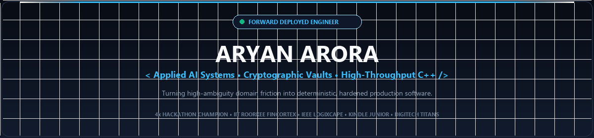

<!-- Executive Header Banner -->

  

<!-- Executive Contact & Status Badges -->

  
  &nbsp;
  
  &nbsp;
  
  &nbsp;
  

---

## Executive Profile & Core Philosophy

<table width="100%">
  <thead>
    <tr style="border-bottom: 2px solid #38bdf8;">
      <th colspan="2" align="left" style="padding: 10px 14px; background-color: #0f172a; color: #38bdf8; font-family: monospace;">
        FORWARD DEPLOYED ENGINEER // DIAGNOSTIC SPECIFICATION
      </th>
    </tr>
  </thead>
  <tbody>
    <tr>
      <td width="22%"><b>Operator</b></td>
      <td><b>Aryan Arora</b> (<code>@FROSTY-MUG</code>) &bull; Forward Deployed Engineer &bull; Systems & Applied AI</td>
    </tr>
    <tr>
      <td><b>Mission Profile</b></td>
      <td><i>"Deconstruct high-ambiguity domain friction, design mathematically grounded architectures, and deploy complete, tested, and high-performance software systems directly to users and clients."</i></td>
    </tr>
    <tr>
      <td><b>Academic Foundation</b></td>
      <td><b>B.Tech in Computer Science &amp; Engineering (AI &amp; Machine Learning Honours)</b> &bull; Graphic Era University</td>
    </tr>
    <tr>
      <td><b>Field Track Record</b></td>
      <td><b>4x 1st Place Hackathon Champion</b> (IIT Roorkee FinCortex &bull; IEEE Logixcape &bull; Kindle Junior 4.0 &bull; DigiTech Titans)</td>
    </tr>
    <tr>
      <td><b>Target Engagements</b></td>
      <td>Forward Deployed Engineer (FDE) &bull; Solutions Engineer &bull; Applied AI & Systems Engineer (Open to Remote / Global Relocation)</td>
    </tr>
  </tbody>
</table>

---

## Forward Deployed Engineering Playbook

How I take complex, unstructured client problems and engineer them into reliable production software:

| Phase | Operating Principle | How It Translates in My Work |
|:---|:---|:---|
| **1. Problem Discovery & Constraints** | Understand domain pain without assuming off-the-shelf software fits. | Identified physical 144-byte NFC limits (`Ghost-Tag`), uncompressed gigabyte bio-sequences (`Genome_Firewall`), and clinical attention dilution in 24k token records (`CareSentry`). |
| **2. Bespoke Systems Architecture** | Write custom algorithms where generic abstractions cause latency or security leaks. | Built zero-copy virtual memory mappers, 4-ary genomic prefix tries, Cauchy Reed-Solomon erasure coding over $\mathrm{GF}(2^8)$, and PyTorch attention-hook estimators. |
| **3. Reliability & Defensive Hardening** | Verify systems mathematically under adversarial and offline conditions. | 347 Jest unit tests, 130 clinical evaluation tests, CodeQL/TruffleHog security gates, and SHA-256 chained audit logs. |
| **4. Operational Delivery** | Deliver accessible, cross-platform client interfaces for end users. | Shipped WebCrypto web clients, desktop PC/SC hardware bridges, interactive Gradio clinician dashboards, and Groq-accelerated executive interfaces. |

---

## Pinned Flagship Systems

<table width="100%">
  <tr>
    <td width="50%" valign="top">
      <h3><a href="https://github.com/FROSTY-MUG/Ghost-Tag">Ghost-Tag</a></h3>
      
<b>Offline-First Zero-Knowledge Encrypted NFC Vault System</b>

      <ul>
        <li><b>Customer Problem:</b> Physical NFC tags (NTAG213/215/216) are unencrypted, constrained (144–888 bytes), and vulnerable to RF sniffing and physical wear.</li>
        <li><b>Delivered Solution:</b> Client-side AES-256-GCM encryption with Argon2id ephemeral key derivation, NDEF authenticated ciphertext envelopes, and Cauchy Reed-Solomon $(N, K)$ multi-tag erasure coding.</li>
        <li><b>FDE Hardware Bridge:</b> Cross-platform Android app, browser WebCrypto client, and desktop Ghost Bridge for local PC/SC and PN532 transceivers.</li>
        <li><b>Verification Evidence:</b> 347 Jest tests across 26 suites, 22 PN532 serial tests, CodeQL scanning, and TruffleHog secret leak prevention.</li>
      </ul>
      

        
        
        
        
        
      

    </td>
    <td width="50%" valign="top">
      <h3><a href="https://github.com/FROSTY-MUG/Genome_Firewall">Genome_Firewall</a></h3>
      
<b>High-Throughput Multithreaded C++ Biosecurity & AMR Defense Engine</b>

      <ul>
        <li><b>Customer Problem:</b> Bacterial superbug detection in raw gigabyte FASTA sequences requires fast, low-cost screening that cannot rely on heavy cloud Python runtimes.</li>
        <li><b>Delivered Solution:</b> Pure C/C++14 engine with zero-copy memory-mapped file parsing (`CreateFileMapping`/`mmap`), 64 KB chunking, custom 40-byte 4-ary genomic prefix trie, and an 8 KB arena block allocator.</li>
        <li><b>Algorithmic Performance:</b> 1 MB Bloom filter for $O(1)$ fast negative rejection, Hamming distance $\le 1$ SNP tolerance, and lock-free atomic multithreaded scoring.</li>
        <li><b>Benchmarked Gains:</b> AMD Ryzen 5 benchmark showed 78.3% trie memory reduction, 12x faster scan time, and 3.4x overall speedup over v1.0 baseline.</li>
      </ul>
      

        
        
        
        
        
      

    </td>
  </tr>
  <tr>
    <td width="50%" valign="top">
      <h3><a href="https://github.com/FROSTY-MUG/CareSentry">CareSentry</a></h3>
      
<b>Deterministic Attention-Anchored Safety Harness for Medical LLMs</b>

      <ul>
        <li><b>Customer Problem:</b> Enterprise clinical models suffer from attention dilution in long patient histories, causing missed contraindications and hallucinated orders.</li>
        <li><b>Delivered Solution:</b> PyTorch forward hooks extract multi-head attention weights across decision layers; blockwise $O(S \cdot K)$ memory bounding evaluates contexts up to 24,000 tokens with depth-stratified z-score controls.</li>
        <li><b>Clinical Invariant Engine:</b> Automated invariant matrix evaluating drug-allergy cross-reactivity, renal dosing (CrCl/eGFR), Beers Criteria, and reverse omissions across 180+ drug aliases via RxNorm Lite and WHO-ATC.</li>
        <li><b>Inference Guardrails:</b> Prompt-injection defense, invariant-guided constrained prefix-trie decoding, and a SHA-256 chained audit trail (2.47 ms CPU latency).</li>
      </ul>
      

        
        
        
        
        
      

    </td>
    <td width="50%" valign="top">
      <h3><a href="https://github.com/FROSTY-MUG/FPA">FPA (FP&A Studio)</a></h3>
      
<b>Real-Time Financial Planning & Analysis Dashboard Powered by Groq & Pinecone</b>

      <ul>
        <li><b>Customer Problem:</b> Corporate FP&A teams spend days consolidating unstructured financial reports and modeling sensitivity scenarios with high manual latency.</li>
        <li><b>Delivered Solution:</b> Direct evolution of 1st-place winning architecture from IIT Roorkee FinCortex (200+ teams). Combines Groq LPU inference with Pinecone vector embeddings for sub-second financial sensitivity forecasting.</li>
        <li><b>Multi-Model Orchestration:</b> Coordinates Google GenAI, Groq LPU, and Mistral models to ingest financial balance sheets, calculate variances, and explain anomalies.</li>
        <li><b>Executive Dashboard:</b> Production Next.js console with real-time financial metrics, automated scenario forecasting, and interactive chart telemetry.</li>
      </ul>
      

        
        
        
        
        
      

    </td>
  </tr>
</table>

---

## Hackathon Championship Track Record

Demonstrated capability to understand enterprise problem statements, architect full systems, and win top national technical competitions under tight deadlines:

- **1st Place Champion &mdash; IIT Roorkee FinCortex:** Architected and deployed a multi-model financial intelligence dashboard with consensus verification in a 72-hour sprint against 200+ engineering teams.
- **1st Place Champion &mdash; IEEE Logixcape:** Ranked 1st across 3 technical rounds covering advanced algorithmic puzzle solving, systems logic, and rapid debugging among 300+ participants.
- **1st Place Champion &mdash; Kindle Junior 4.0 (IEEE - GEU):** Delivered an AI student evaluation and career recommendation pipeline with multi-stage LLM evaluation workflows.
- **1st Place Champion &mdash; DigiTech Titans:** Solved 8 intensive systems and full-stack challenges in 84 minutes, placing 1st in accuracy and execution velocity.

---

## Technical Capabilities & Tooling

### 💻 Core Languages

  

### ⚙️ Systems, Backend & Infrastructure

  

  
  
  
  

### 🧠 Applied AI, Cryptography & Databases

  

  
  
  
  

### 🧪 Quality Engineering & Security Audits

  

  
  

---

## Live GitHub Activity & Telemetry

<table border="0" width="100%">
  <tr>
    <td align="center" width="50%">
      
    </td>
    <td align="center" width="50%">
      
    </td>
  </tr>
  <tr>
    <td colspan="2" align="center">
      
    </td>
  </tr>
</table>

<!-- BEGIN:DYNAMIC_METRICS -->
| Metric | Telemetry Count | Verification Source |
|:---|:---:|:---|
| **Public Systems Repositories** | `9` | GitHub REST API v3 |
| **Total Stargazers Received** | `5` | Verified Public Stars |
| **Automated Bot Telemetry Pipeline** | Active | Scheduled GitHub Actions (`0 0,12 * * *`) |
| **Telemetry Harvest Timestamp** | `2026-11-28 05:11:32 UTC` | Automated Bot Sync |

#### Pinned Systems Health & Deployment State

| Pinned System | Primary Stack | Stars | Forks | Last Pushed | Verification & Status |
|:---|:---|:---:|:---:|:---:|:---|
| **[Ghost-Tag](https://github.com/FROSTY-MUG/Ghost-Tag)** | `TypeScript` &bull; `C++17` &bull; `NFC` | 4 ⭐ | 2 🍴 | `2026-11-25` | `v2.0.6` Released &bull; 347 Jest Tests &bull; Staging `v2.1.0` |
| **[Genome_Firewall](https://github.com/FROSTY-MUG/Genome_Firewall)** | `C++14` &bull; `POSIX mmap` &bull; `Threads` | 1 ⭐ | 4 🍴 | `2026-11-22` | Zero-Copy Parser &bull; 3.4x Wall-Clock Speedup |
| **[CareSentry](https://github.com/FROSTY-MUG/CareSentry)** | `Python` &bull; `PyTorch` &bull; `MCP` | 0 ⭐ | 1 🍴 | `2026-10-10` | 130 Tests Passing &bull; Invariant Safety Harness |
| **[FPA](https://github.com/FROSTY-MUG/FPA)** | `TypeScript` &bull; `Groq` &bull; `Pinecone` | 0 ⭐ | 1 🍴 | `2026-04-08` | 1st Place IIT Roorkee FinCortex &bull; Real-time AI |
<!-- END:DYNAMIC_METRICS -->

---

## Let's Connect

  <b>Open to Forward Deployed Engineer (FDE), Solutions Engineer, and Applied AI / Systems Engineering roles.</b>

  
  &nbsp;
  
  &nbsp;
  

  Last refreshed automatically from public GitHub activity via GitHub Actions on P26-11-25<!-- END:LAST_UPDATED -->.

